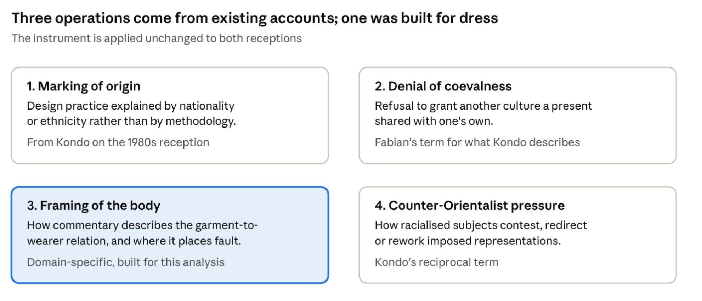
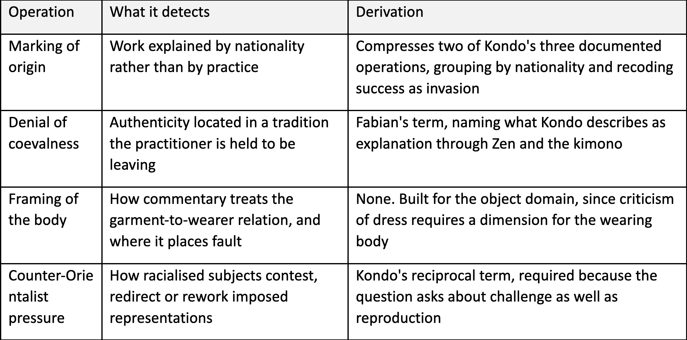
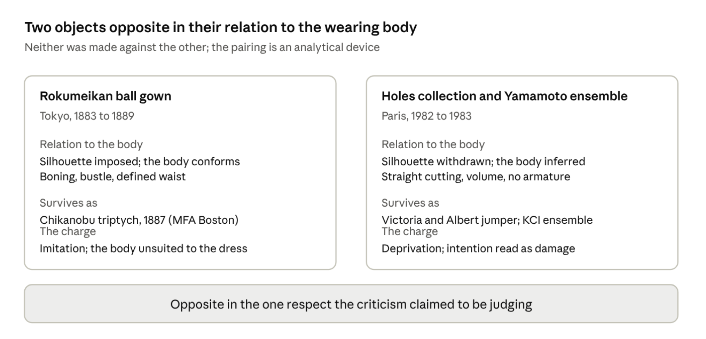
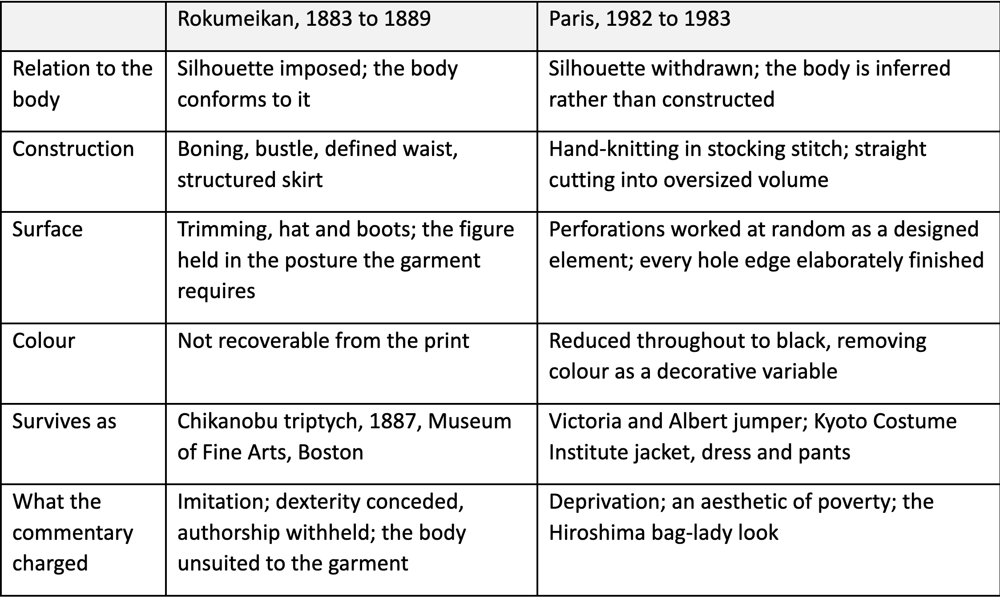
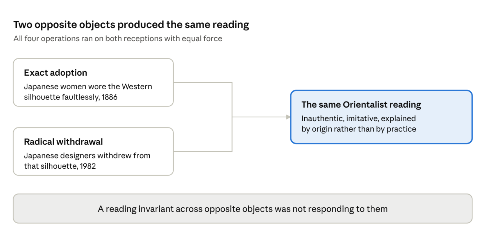
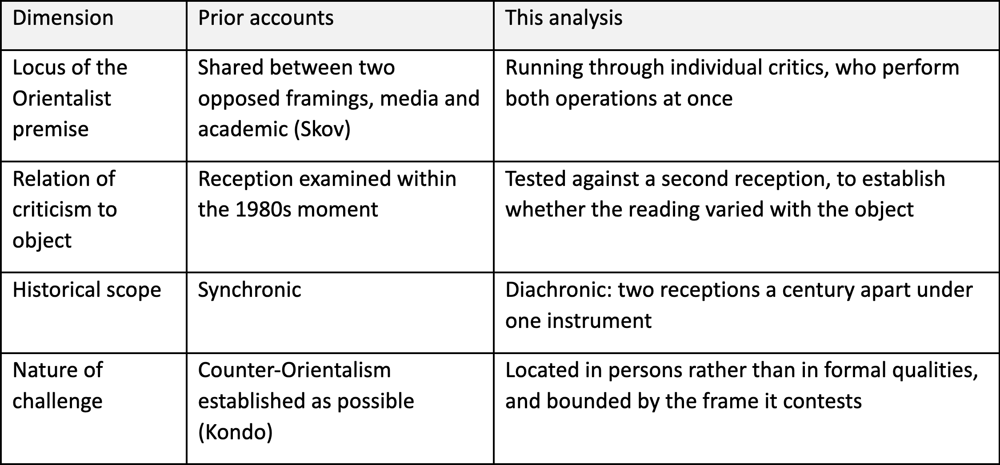
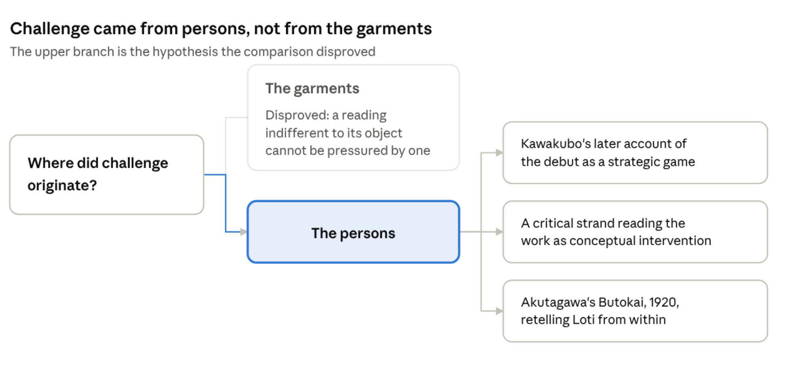

# Reflective Commentary

## Authorial Intention

The Western reception of Japanese fashion has been studied largely as a problem of interpretation. 
- Skov's account of the 1980s describes a reception split between a media framing that exoticised the collections and an academic framing that valorised them, with both resting on an Orientalist premise
- Kondo documents how the press grouped designers by nationality, explained their work through Zen and the kimono, and recoded their success as invasion
- Kawamura shows ethnicity circulating as a commodity within fashion journalism. 

The debate about how the West views Japanese fashion isn't new; it has been happening since the late 1800s (the Meiji era). Ever since Japanese people first started wearing Western clothing, Western observers stopped seeing just clothes and started treating Japanese bodies as a test of how "modern" Japan really was

However, past research has mostly focused on how specific outfits were judged, assuming the debate was just a conflict between hostile critics and praising critics. Both sides made one major assumption: they believed Western critics were actually looking at and responding to the clothes themselves.

My intention is to test that assumption. Through a comparative analysis of two receptions a century apart, I set out to establish whether Orientalist framing in fashion criticism varies with the object it describes, or operates independently of form, silhouette and aesthetic intent. The question I ask is **to what extent Western fashion criticism's framing of Rei Kawakubo and Yohji Yamamoto's early 1980s Paris debuts reproduced or challenged Orientalist representations of Japanese modernity.**

To do this I construct a dual-layered historical and theoretical framework.

---

## I. Constructing a Purpose-Built Instrument

Rather than relying on description, I assemble an analytical instrument from postcolonial accounts of representation, drawing on Said's *Orientalism*, Bhabha's mimicry, Fabian's denial of coevalness, and Kondo's counter-Orientalism. It consists of four operations:

1. **Marking of origin:** explaining design practice by nationality or ethnicity rather than by individual methodology.
2. **Denial of coevalness:** refusing to grant a non-Western culture a present shared with one's own.
3. **Framing of the body:** how commentary describes the relation between garment and wearing body, and where it locates fault when the two do not correspond.
4. **Counter-Orientalist pressure:** how racialised subjects contest, redirect or rework imposed representations.

Three of these derive from accounts written independently of my argument:

- The **first** and **second** compress Kondo's description of the 1980s reception, with Fabian supplying a name for what she describes.
- The **fourth** is Kondo's reciprocal term, and the research question requires it, since a question asking whether criticism reproduced *or* challenged cannot be answered by an instrument capable of detecting only one.
- The **third** has no theoretical derivation and is domain-specific, because an instrument for analysing criticism of dress needs a dimension for the wearing body, which neither Narumi nor Kondo supplies since neither writes about garments specifically.
> This does not weaken the rigor: The other three were derived from theory but represent the socio political dimension, while analyzing fashion criticism requires an explicit tool for the wearing body.
> The ultimate test, is whether your instrument can successfully isolate your variable: The third dimension provides the exact metric needed to compare how critics assigned fault to the body across both eras, making the experiment logically airtight.

Throughout, the instrument is located in criticism rather than in garments. The question concerns what Western commentary produced, not what the designers intended.

---

## II. Isolating the Variable of Design

I pair the 1980s Paris debuts of Rei Kawakubo and Yohji Yamamoto with the 1880s Meiji-era adoption of Western ball gowns at the Rokumeikan, and apply the four operations to both.

- **1880s, Rokumeikan.** Japanese women adopted the Western silhouette exactly. Loti's account reduced that adoption to imitation, conceding dexterity while withholding authorship, and found the Japanese body unsuited to the garment rather than the garment unsuited to the body.
- **1980s, Paris.** Japanese designers withdrew from the Western silhouette. The commentary read deliberate formal strategies as deprivation, naming the result an aesthetic of poverty and, in its most hostile register, a Hiroshima bag-lady look.

Even though the two outfits were complete opposites in how they interacted with the body, critics judged them using the exact same biased framework. If the criticism were actually about the clothes, the critics would have reacted differently to two totally different styles. Instead, their reactions didn't change at all based on what they were looking at, proving they were judging the creators' national background rather than the actual design.

### A note on how this finding arrived

I didn't set up this comparison to get this specific outcome; honestly, my initial guess was wrong. I originally thought the clothes themselves were so radically different that they forced critics to push back against their own biases. But the comparison proved that wasn't true. If critics weren't even really paying attention to the clothes, an outfit—no matter how groundbreaking—couldn't force them to change their minds, meaning any real pushback had to come from somewhere else.

Also, these two outfits didn't naturally exist as a pair in history. I put them side-by-side myself as a tool for analysis. Nothing in history links them together, and one was never designed as a direct response to the other.

---

## III. Reframing the Trigger of Criticism

I then want to shift attention from fashion as visual art toward fashion as an arena of geopolitical and institutional anxiety.

The existing accounts I build on are closer to allies than to opponents, and I should be precise about where I depart from them. 

- Skov argues that the 1980s reception was split between a media framing that exoticised and an academic framing that valorised, and that both rested on an Orientalist premise. 
- Kawamura applies Said to fashion and argues that ethnicity is commodified by fashion journalism. Neither treats criticism as a transparent evaluation of form. 

My disagreement with past research is actually very small. While Lise Skov argues that the Orientalist viewpoint is split between two opposing groups of critics (the hostile mainstream media versus the supportive academics), I found that this exact same division actually runs through individual critics, who end up doing both things at once. Also, previous scholars never tried using a diachronic comparison across different historical eras like I did.

Three mechanisms support the reframing.

- **Geopolitical and economic anxiety.** The collections did not arrive in an aesthetic vacuum. Tropes of invasion, unfair practice and imitation were already circulating in Western coverage of the trade conflict, and techno-orientalism supplied a formation in which Japan was construed as technologically advanced yet culturally inscrutable. The vocabulary was waiting for the garments rather than produced by them.
- **Institutional and aesthetic transgression.** Within a Paris system governed by the Chambre Syndicale and dominated by a body-conscious silhouette of padded shoulders and defined waist, the designers entered through the prêt-à-porter calendar as peers claiming creative authority. The system had procedures for assimilating novelty within its own ranks, and none for assimilating them.
- **The invariance of the reading.** Set side by side, a faultlessly correct silhouette and a deliberately unfinished one attracted the same charge of inauthenticity ninety-five years apart.

What I am claiming here is very specific. Across these two historical moments, the way critics read the clothes did not change at all, no matter what the outfits actually looked like. I am not saying the clothes themselves didn't matter—in fact, section 6 goes into technical detail about how they were made because they were genuinely groundbreaking alternatives. What the comparison proves is simply that the critics weren't paying attention to that innovation.

---

## IV. Complicating the Concept of Agency

I resist a binary of dominant West against resistant East. Drawing on Kondo's counter-Orientalisms, I argue that challenge existed but was ambivalent, and operated from within the frame it contested.

- **Where the counter-pressure came from.** Not from the formal qualities of the garments, but from the people the commentary described: 
    - Kawakubo's later characterisation of the debut as a game to establish the house's position; a critical strand that read the work as a conceptual intervention and recorded the derisive register as one position among several
    - and Akutagawa's *Butōkai* of 1920, which retold Loti's evening from the viewpoint of one of the women he had described.
- **How it remained bounded.** 
    - Koda traced the look to Westwood and McLaren rather than to any Japanese origin, yet grounded the aesthetic in a sensibility derived from Zen. 
    - Duka relocated Yamamoto's work into London street fashion while reaching for the shapes of ancient Japan in the same sentence. 
    - Akutagawa's rewriting carried its own imperial ambivalence. The critics who discarded explanation by origin substituted another ethnic term for it rather than evaluating on design logic.

Real pushback against this system doesn't mean completely destroying it or running away from it. Instead, it is a complicated, back-and-forth negotiation that has to happen using the exact rules and terms that the dominant group already set up.

---

## Answering the Research Question

**To what extent did Western fashion criticism's framing of Rei Kawakubo and Yohji Yamamoto's early 1980s Paris debuts reproduce or challenge Orientalist representations of Japanese modernity?**

| Analytical dimension | What the prior accounts establish | What this analysis adds |
| --- | --- | --- |
| **Locus of the Orientalist premise** | Shared between two opposed framings, media and academic (Skov) | Running through individual critics, who perform both operations at once |
| **Relation of criticism to object** | Reception examined within the 1980s moment | Tested against a second reception, to establish whether the reading varied with the object |
| **Historical scope** | Synchronic, 1980s | Diachronic, two receptions a century apart under one instrument |
| **Nature of challenge** | Counter-Orientalism established as possible (Kondo) | Located in persons rather than in formal qualities, and bounded by the frame it contests |

The evidence supports an answer that is neither reproduction nor challenge but a particular relation between them. Western fashion criticism reproduced Orientalist representations structurally rather than contingently, since the operations ran independently of what the garments did and no object could have disarmed a reading that was not attending to it. Challenge was correspondingly displaced: it did not reside in the cuts, edges and volumes of the garments, but emerged through the statements and rewritings of the people the commentary described, and remained shaped by the frame it contested.

What follows from this is modest rather than sweeping. The structure has proved durable, and a vocabulary explaining practice by national sensibility remains available whenever work from outside the Western field requires accounting for. The remedy lies neither in better objects nor in more sympathetic criticism, since sympathy reproduced the operations as faithfully as hostility did. It lies in attending to what a given reading is attending to, a question answerable only when a reception is set against the object it claims to describe.